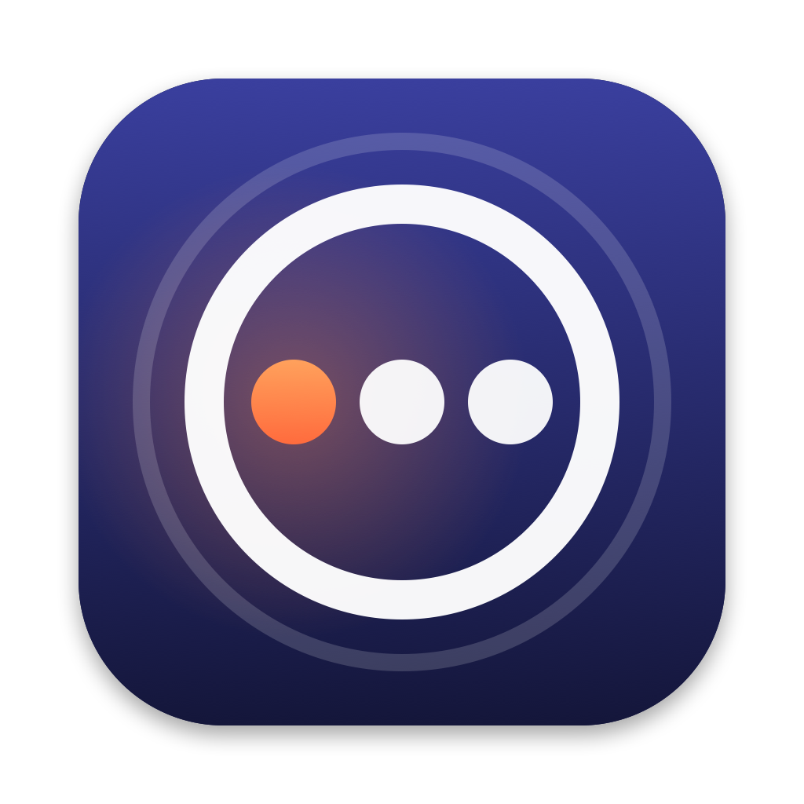
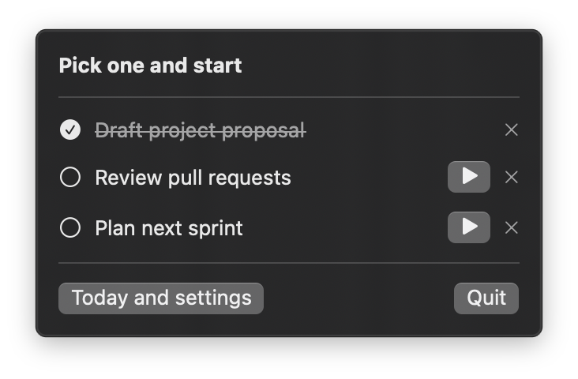
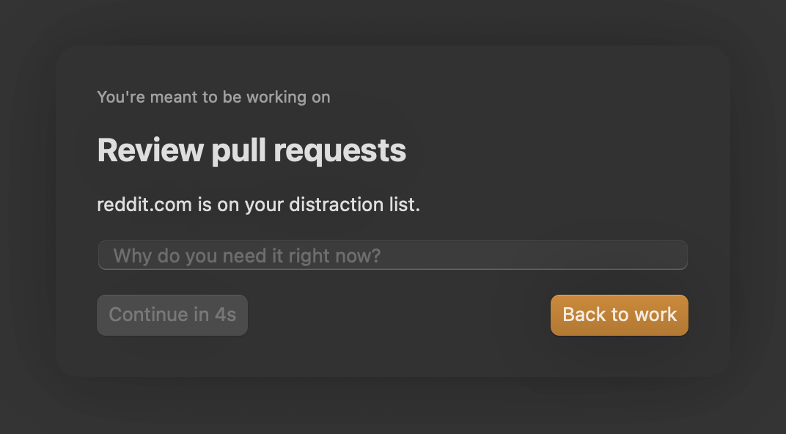
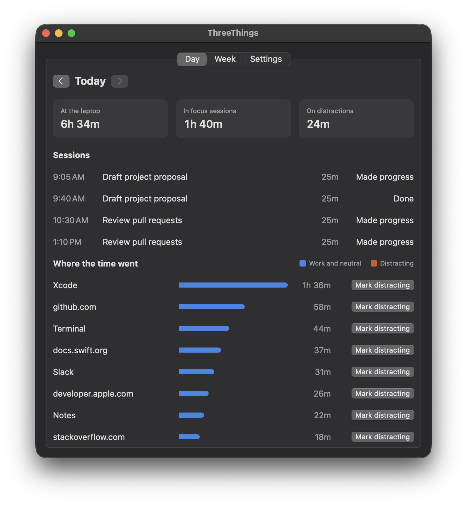
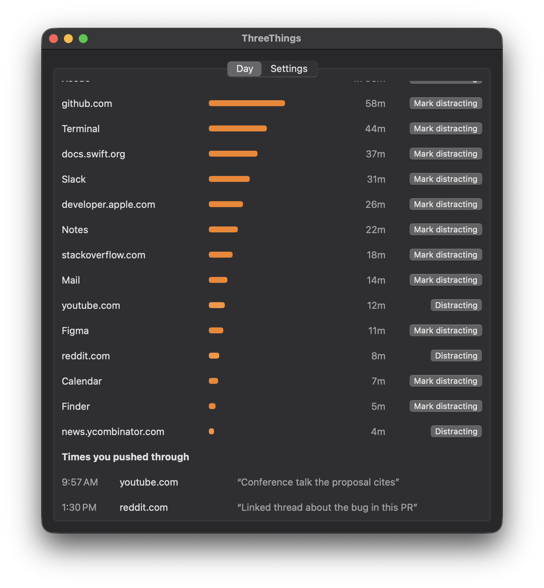
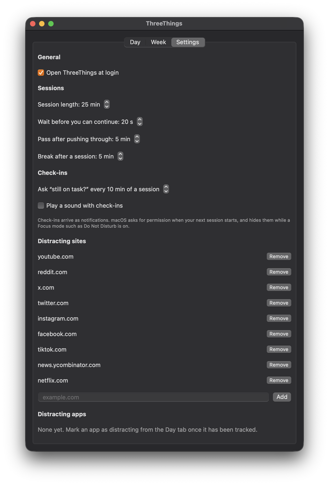

# ThreeThings

A macOS menu bar app for staying on task. You pick up to three tasks for the day, start a timed session on one, and the app adds friction when you drift to a distracting site or app. It also logs where your time goes.



## Screenshots

| Pick a task and start | Friction on a distracting site |
| --- | --- |
|  |  |

| The day at a glance | Where the time went |
| --- | --- |
|  |  |

| Settings |
| --- |
|  |

## What it does

- **Start:** choose up to three tasks for today from the menu bar. Pressing play on one starts a focus session (25 minutes by default) and pins the task and countdown in the menu bar. Tasks you didn't finish carry over to the next day you open the app.
- **During a session:** opening a site or app on your distraction list dims the screen and shows the task you committed to. You can go back to work, or wait out a timer (20 seconds by default) and type a reason to continue for a few minutes. One minute before that pass runs out, a small reminder appears. Every ten minutes by default, a "still on task?" notification checks in; it needs no answer and leaves on its own.
- **After:** when the timer ends, or you press Finish, the app asks whether you did it. "Done" ticks the task off.
- **All day:** the app records which app is in front and, in supported browsers, which site. The Day tab shows time at the laptop, time in sessions, time on distractions, a per-app and per-site breakdown, and every time you pushed through the friction screen along with the reason you gave.
- **Over the week:** the Week tab charts focus session time against distraction time for the last seven days, with totals and the number of sessions you marked done. The arrows step back seven days at a time.

Tracking pauses after two minutes without keyboard or mouse input. Friction only applies during a session.

## Supported browsers

Per-site tracking and site friction work in:

- Orion
- Google Chrome
- Brave
- Safari
- Microsoft Edge, Vivaldi, Opera, Chromium and Arc

Orion has had the most use. Safari, Edge, Vivaldi, Opera, Chromium and Arc are wired up through the same scripting interface but have not been tested. In Safari, "Back to work" closes the tab unless "Allow JavaScript from Apple Events" is turned on in its developer settings, in which case it goes back a page. Firefox has no scripting interface, so it cannot be supported this way.

Any other browser is tracked as a single app. You can mark the whole browser as distracting from the Day tab.

## Requirements

- macOS 14 or later
- Xcode, or the Swift command line tools

## Build and run

Build the app:

```bash
./build.sh
```

Build and launch it (this quits any running copy first):

```bash
./build.sh run
```

The script produces `ThreeThings.app` in this folder. Look for the target symbol in the menu bar; the app has no Dock icon.

To start it at login, turn on "Open ThreeThings at login" in the Settings tab.

## Tests

```bash
swift test
```

The tests cover the data layer: the blocklist, the three-task limit, task carry-over, the session lifecycle, activity logging, the weekly totals, check-in timing, and saving and loading, including files saved by older versions. They use a temporary file and never touch your real data.

## Permissions

The first time a supported browser is in front, macOS asks whether ThreeThings may control it. The app uses this to read the address of the current tab and, when you press "Back to work", to go back a page or close the tab. Without it, that browser is tracked as one app with no site friction.

When your first session with check-ins starts, macOS also asks whether ThreeThings may send notifications. If you decline, check-ins appear as a small message at the top of the screen instead. macOS hides notifications while a Focus mode such as Do Not Disturb is on.

The app is signed locally, so macOS may ask again after each rebuild.

## Settings

Open "Today and settings" from the menu bar, then the Settings tab:

| Setting | Default |
| --- | --- |
| Open ThreeThings at login | off |
| Session length | 25 minutes |
| Wait before you can continue | 20 seconds |
| Pass after pushing through | 5 minutes |
| Check-in during a session | every 10 minutes (0 turns it off) |
| Play a sound with check-ins | off |
| Distracting sites | youtube.com, reddit.com, x.com, twitter.com, instagram.com, facebook.com, tiktok.com, news.ycombinator.com, netflix.com |
| Distracting apps | none |

A site entry covers its subdomains, so `youtube.com` also matches `m.youtube.com`. To add an app, use "Mark distracting" next to it in the Day tab once it has been tracked.

## Your data

Everything is stored on this Mac in `~/Library/Application Support/ThreeThings/data.json`, readable only by your account. The app makes no network connections.

The file holds your tasks, sessions, settings, the reasons you typed on the friction screen, and the activity log. The log records app names and site names only, not full addresses or page titles, and entries older than 60 days are dropped at launch.

To reset the app, quit it and delete that file.

## Project layout

| Path | Contents |
| --- | --- |
| `Sources/ThreeThings/Core.swift` | Data models, saving and loading, tasks, sessions, blocklist |
| `Sources/ThreeThings/Tracker.swift` | Activity tracking, browser scripting, check-in notifications, the friction and end-of-session screens |
| `Sources/ThreeThings/Views.swift` | Menu bar popover, Day, Week and Settings tabs |
| `Tests/ThreeThingsTests/StoreTests.swift` | Unit tests for the data layer |
| `icon/make_icon.swift` | Draws the app icon; `icon/AppIcon.icns` is the built result |
| `build.sh` | Builds, bundles and signs the app |
| `Info.plist`, `ThreeThings.entitlements` | Bundle settings and the browser-scripting entitlement |

To support another browser that uses the standard Chromium scripting dictionary, add one line to `Browser.all` in `Tracker.swift` with its bundle identifier.

To redraw the icon after editing `make_icon.swift`:

```bash
swift icon/make_icon.swift icon/ThreeThings-icon.png
```

`AppIcon.icns` then needs regenerating from that PNG with `sips` and `iconutil`.

## Known limits

- Friction is a nudge, not a lock: quitting ThreeThings removes it.
- The friction screen covers the main display only.
- The tests cover the data layer only. The friction screen and the check-in have had only hands-on testing, and browsers other than Orion have had little or none.
- The app is not sandboxed and is signed ad hoc, so there is no downloadable build: build it from source on the Mac you want to use it on.

## Licence

MIT. See [LICENSE](LICENSE).
